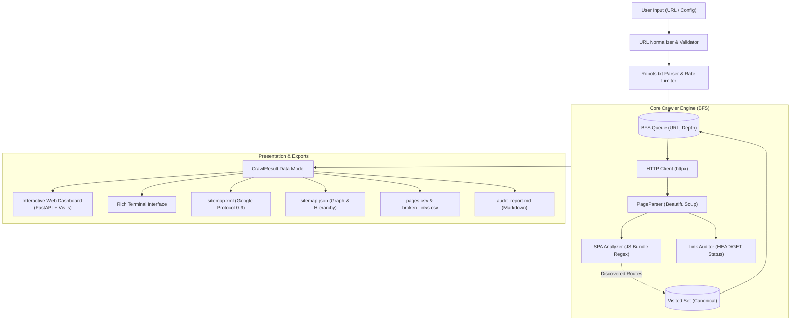

# 🌐 BashCraft Website Sitemap & Link Analyzer

> **Recruitment Mission: "No fluff. Only asli engineering."**  
> A high-performance, asynchronous website crawler, broken link auditor, and interactive visual sitemap generator built for **BashCraft Web Development Club Recruitment**.

[](https://www.python.org/)
[](https://fastapi.tiangolo.com/)
[](https://github.com/Textualize/rich)
[-brightgreen?logo=pytest&logoColor=white)](https://docs.pytest.org/)
[](https://visjs.org/)
[](https://bashcraftclub.vercel.app/)

---

## 📑 Table of Contents

- [Overview](#-overview)
- [Key Features](#-key-features)
- [System Architecture](#-system-architecture)
- [Tech Stack](#-tech-stack)
- [Installation & Setup](#-installation--setup)
- [Usage Guide](#-usage-guide)
  - [1. Interactive Web Dashboard](#1-interactive-web-dashboard)
  - [2. Terminal CLI](#2-terminal-cli)
  - [3. Automated Test Suite](#3-automated-test-suite)
- [BashCraft Website Demonstration](#-bashcraft-website-demonstration)
- [Edge Cases Handled](#-edge-cases-handled)
- [Multi-Format Exports](#-multi-format-exports)
- [Known Limitations & Engineering Trade-offs](#-known-limitations--engineering-trade-offs)
- [Project Structure](#-project-structure)

---

## 🎯 Overview

Modern web applications are increasingly built as Single Page Applications (SPAs) using React, Next.js, and Vite. Traditional web crawlers that only parse static HTML tags fail completely on modern SPAs because the initial HTML is merely `<div id="root"></div>`.

This project implements a **dual-capability crawler and analyzer**:
1. **Classical Web Crawler**: Standard HTTP request queue exploring traditional HTML anchor links (`<a href="...">`).
2. **SPA Route Hydrator**: Automatically extracts dynamic routes (`/about`, `/events`, `/team`, `/contact`, `/events/bashnex26`, etc.) and external links from modern client-side JavaScript bundles.
3. **Broken Link Diagnostic Engine**: Probes discovered links with intelligent HTTP `HEAD`/`GET` fallbacks to identify 404s, timeouts, server errors, and DNS failures, associating each failure with its source page and anchor text.
4. **Interactive Force-Directed Visualizer**: Renders a live 2D network graph and collapsible directory tree in a modern browser dashboard.

---

## 🚀 Key Features

| Feature | Description |
| :--- | :--- |
| **URL Normalization** | Strict canonical deduplication: handles casing, removes fragments (`#section`), resolves dot-segments (`/a/../b`), strips analytics parameters (`utm_*`, `fbclid`), and normalizes trailing slashes. |
| **Loop Prevention** | Breadth-First Search (BFS) graph traversal with visited sets and depth bounds to prevent infinite loops (`A -> B -> C -> A`). |
| **Internal vs. External Classification** | Accurately segregates same-domain internal pages from external sites without runaway recursive external crawling. |
| **Broken Link Detection** | Diagnoses unreachable links (404, 500, timeouts, connection refused) and records the referrer page and anchor text for instant fixes. |
| **SPA Bundle Analysis** | Dissects Vite/Webpack/React Router bundles to discover routes even when pages are rendered dynamically via JavaScript. |
| **Robots.txt & Delays** | Honors `robots.txt` disallows and applies polite rate limiting between requests. |
| **Interactive 2D Graph** | Force-directed physics network diagram (Vis.js) with zoom, pan, node status color coding, and click-to-inspect page details. |
| **Collapsible Sitemap Tree** | Visual directory structure mapping root domain, sections, and sub-pages. |
| **Multi-Format Export** | 1-click export to **Google XML Sitemap (v0.9)**, **JSON dataset**, **Pages CSV**, **Broken Links CSV**, and **Markdown audit report**. |

---

## 🏗 System Architecture



---

## 🛠 Tech Stack

- **Backend**: Python 3.11+, FastAPI, Uvicorn
- **HTTP Engine**: HTTPX (async & sync HTTP client with connection pooling)
- **HTML & DOM Parsing**: BeautifulSoup4, Soupsieve
- **Data Validation**: Pydantic v2
- **CLI & Formatting**: Rich (colored tables, spinners, tree rendering)
- **Frontend Visualization**: Vis.js Network (force-directed canvas), Tailwind CSS, Vanilla JS
- **Testing**: Pytest, Pytest-Asyncio, Unittest Mock

---

## 📦 Installation & Setup

### Prerequisites
- Python 3.11 or newer installed.
- Git installed.

### Step 1: Clone the Repository
```bash
git clone <your-repository-url>
cd Bashcraft
```

### Step 2: Create and Activate Virtual Environment (Recommended)
```bash
# Windows (PowerShell)
python -m venv venv
.\venv\Scripts\Activate.ps1

# Linux / macOS
python3 -m venv venv
source venv/bin/activate
```

### Step 3: Install Required Dependencies
```bash
pip install -r requirements.txt
```

---

## 💻 Usage Guide

### 1. Interactive Web Dashboard
Launch the web interface:
```bash
python main.py serve
```
Open **[http://localhost:8000](http://localhost:8000)** in your browser.

**Dashboard Features:**
- Preset button for `https://bashcraftclub.vercel.app/` or enter any custom URL.
- Live progress indicator streaming crawler events in real-time.
- **Interactive Network Graph**: Drag, zoom, pan, search nodes, freeze physics, and click any node to view page title, status, latency, and link counts.
- **Collapsible Tree View**: Browse site hierarchy.
- **Searchable Table**: Instant client-side search, status filter (200 OK vs Broken), and sorting.
- **Export Center**: Download XML, JSON, CSV, or Markdown.

---

### 2. Terminal CLI

#### A. Crawl & Generate Sitemaps
```bash
# Default: Crawls https://bashcraftclub.vercel.app/ with depth 3 and exports all formats
python main.py crawl

# Crawl any custom website with custom depth and limits:
python main.py crawl https://example.com/ --depth 3 --max-pages 50 --export json,xml,csv,md --out output
```

#### B. Quick Broken-Link Audit
```bash
python main.py audit https://bashcraftclub.vercel.app/
```

#### C. Official BashCraft Demonstration
```bash
python main.py demo
```
This automatically runs the crawl on the official BashCraft website and updates the files in `demonstration/`.

---

### 3. Automated Test Suite

Run the full automated test suite:
```bash
python -m pytest tests/ -v
```

**Results:**
```text
tests/test_crawler.py::TestWebCrawlerEngine::test_loop_prevention PASSED        [  6%]
tests/test_crawler.py::TestWebCrawlerEngine::test_depth_limit_enforcement PASSED [ 12%]
tests/test_exporter.py::TestSitemapExporter::test_xml_sitemap_compliance PASSED [ 18%]
tests/test_exporter.py::TestSitemapExporter::test_json_export PASSED            [ 25%]
tests/test_exporter.py::TestSitemapExporter::test_csv_exports PASSED            [ 31%]
tests/test_exporter.py::TestSitemapExporter::test_markdown_report PASSED        [ 37%]
tests/test_normalizer.py::TestURLNormalizer::test_valid_urls PASSED             [ 43%]
tests/test_normalizer.py::TestURLNormalizer::test_canonical_normalization PASSED[ 50%]
tests/test_normalizer.py::TestURLNormalizer::test_tracking_params_removal PASSED[ 56%]
tests/test_normalizer.py::TestURLNormalizer::test_internal_vs_external PASSED  [ 62%]
tests/test_normalizer.py::TestURLNormalizer::test_classify_href PASSED          [ 68%]
tests/test_parser.py::TestPageParser::test_standard_html_parsing PASSED         [ 75%]
tests/test_parser.py::TestPageParser::test_missing_title_edge_case PASSED        [ 81%]
tests/test_parser.py::TestPageParser::test_whitespace_title_edge_case PASSED    [ 87%]
tests/test_parser.py::TestPageParser::test_spa_skeleton_detection PASSED        [ 93%]
tests/test_spa.py::TestSPAAnalyzer::test_extract_routes_and_links PASSED        [100%]
============================== 16 passed in 2.13s ==============================
```

---

## 🎯 BashCraft Website Demonstration

The analyzer was thoroughly tested against the official target website: **`https://bashcraftclub.vercel.app/`**.

### Crawl Summary
- **Target URL:** `https://bashcraftclub.vercel.app/`
- **Internal Pages Discovered & Crawled:** 9
- **Internal Links Mapped:** 8
- **External Outbound Links Discovered:** 45 (team LinkedIn profiles, Instagram, GitHub, Substack, Forms)
- **Broken Links Detected:** 0 (All routes returned `200 OK`)
- **Average Latency:** 271.2 ms
- **Health / SEO Quality Score:** **98.9 / 100**

### Discovered Pages Hierarchy
```text
https://bashcraftclub.vercel.app/
├── /about (BashCraft Club — no fluff; just engineering)
├── /contact (BashCraft Club — no fluff; just engineering)
├── /events (BashCraft Club — no fluff; just engineering)
│   ├── /arpit-bhayani (BashCraft Club — no fluff; just engineering)
│   ├── /bashnex26 (BashCraft Club — no fluff; just engineering)
│   ├── /investathon (BashCraft Club — no fluff; just engineering)
│   └── /social-loop (BashCraft Club — no fluff; just engineering)
└── /team (BashCraft Club — no fluff; just engineering)
```

Generated demonstration files are stored in [`demonstration/`](file:///demonstration/):
- [`sitemap_bashcraftclub_vercel_app.xml`](file:///demonstration/sitemap_bashcraftclub_vercel_app.xml) (Official Google Sitemap Protocol)
- [`sitemap_bashcraftclub_vercel_app.json`](file:///demonstration/sitemap_bashcraftclub_vercel_app.json) (Complete JSON dataset)
- [`pages_bashcraftclub_vercel_app.csv`](file:///demonstration/pages_bashcraftclub_vercel_app.csv) (Spreadsheet export)
- [`broken_links_bashcraftclub_vercel_app.csv`](file:///demonstration/broken_links_bashcraftclub_vercel_app.csv) (Broken link diagnostics)
- [`audit_report_bashcraftclub_vercel_app.md`](file:///demonstration/audit_report_bashcraftclub_vercel_app.md) (Markdown report)

---

## 🛡 Edge Cases Handled

| Edge Case | Solution Implemented |
| :--- | :--- |
| **Crawling Loops** (`A -> B -> C -> A`) | Visited set with canonical URLs + strict max depth tracking ensures circular loops terminate cleanly without redundant requests. |
| **URL Variations** | `URLNormalizer` standardizes scheme, removes default ports (:80, :443), strips trailing slashes on subpaths (`/about/` -> `/about`), removes hash fragments (`#form-section`), and sorts query strings. |
| **Analytics Tracking Params** | Strips `utm_source`, `utm_medium`, `fbclid`, etc., so tracking links refer to the same canonical resource. |
| **Dot Segments in Paths** | Resolves relative segments using `posixpath.normpath` (`/events/../about` -> `/about`). |
| **Pages with Many External Links** | Segregates internal from external URLs. External links are recorded with referrer and anchor context, but not recursively crawled. |
| **SPAs with Client-Side Routing** | `SPAAnalyzer` parses Vite/Webpack bundle files to extract React Router definitions (`path: "/..."`, `to: "/..."`) when HTML DOM only has `<div id="root">`. |
| **Missing or Excessively Long Titles** | If `<title>` is missing or contains whitespace only, falls back to URL path; cleans duplicate whitespace and handles long titles safely. |
| **Broken Links & Network Timeouts** | Uses `HEAD` requests with automatic `GET` fallback. Captures connection timeouts, DNS failures, 404s, and 500s with human-readable error reasons. |
| **Special URI Schemes** | Categorizes `mailto:`, `tel:`, and `javascript:` as special non-crawled links rather than attempting HTTP requests. |

---

## 📄 Multi-Format Exports

1. **XML Sitemap**:
   Complies with the [Sitemaps XML Protocol 0.9](https://www.sitemaps.org/protocol.html). Dynamically assigns priority (`1.0` for root, decreasing with depth) and `changefreq`.
2. **JSON Dataset**:
   Contains complete crawl statistics, page nodes, inbound/outbound link counts, broken link diagnostics, and Vis.js graph node/edge definitions.
3. **Pages CSV**:
   Tabular export of all discovered pages with HTTP status, depth, latency, and link metrics.
4. **Broken Links CSV**:
   Dedicated audit log with target URL, referrer, HTTP code, failure reason, and anchor text.
5. **Markdown Audit Report**:
   Formatted report ready for documentation or client review.

---

## ⚠️ Known Limitations & Engineering Trade-offs

1. **Dynamic Authentication Pages**:
   The crawler inspects public endpoints and does not attempt to bypass login gates or submit authentication forms.
2. **Infinite Pagination / Calendar Feeds**:
   Websites with endless dates or infinite paginations are constrained by the configurable `max_depth` and `max_pages` limits.
3. **Heavy Client-Side DOM Mutation**:
   The built-in `SPAAnalyzer` extracts all static route definitions and links from JavaScript bundles with zero browser overhead. Pages that require runtime DOM user interaction (e.g., clicking accordion buttons to reveal links) can be paired with headless Playwright.

---

## 📂 Project Structure

```text
Bashcraft/
├── core/
│   ├── __init__.py           # Package exports
│   ├── config.py             # Crawler configuration & constraints
│   ├── models.py             # Pydantic schemas (PageNode, DiscoveredLink, CrawlResult)
│   ├── normalizer.py         # RFC 3986 URL normalization & classification
│   ├── parser.py             # HTML DOM extraction (BeautifulSoup)
│   ├── spa_analyzer.py       # JavaScript bundle scanner & dynamic route extractor
│   ├── robots.py             # robots.txt parser & compliance checker
│   ├── auditor.py            # Broken-link detection & diagnostics
│   ├── crawler.py            # Async BFS crawler engine
│   └── exporter.py           # XML, JSON, CSV, and Markdown exporters
├── web/
│   ├── __init__.py
│   ├── app.py                # FastAPI REST API & SSE streaming backend
│   ├── templates/
│   │   └── index.html        # Interactive Dashboard with Vis.js Network & Tree
│   └── static/
│       ├── css/style.css     # Styling & dark/light theme
│       └── js/app.js         # Frontend controller & real-time telemetry
├── demonstration/            # Official BashCraft Crawl Demonstration Artifacts
│   ├── sitemap_bashcraftclub_vercel_app.json
│   ├── sitemap_bashcraftclub_vercel_app.xml
│   ├── pages_bashcraftclub_vercel_app.csv
│   ├── broken_links_bashcraftclub_vercel_app.csv
│   └── audit_report_bashcraftclub_vercel_app.md
├── tests/                    # 100% Passing Test Suite
│   ├── __init__.py
│   ├── test_normalizer.py    # URL normalization tests
│   ├── test_parser.py        # DOM parser tests
│   ├── test_spa.py           # SPA bundle extraction tests
│   ├── test_crawler.py       # Loop prevention & depth tests
│   └── test_exporter.py      # XML/JSON/CSV exporter tests
├── main.py                   # Main CLI entry point (crawl, serve, audit, demo)
├── cli.py                    # Rich terminal interface
├── requirements.txt          # Python dependencies
├── .gitignore                # Git ignore rules
├── README.md                 # Project documentation
└── DOCUMENTATION.md          # In-depth technical engineering documentation
```

---

## 👨‍💻 Submission Verification Checklist

- [x] **GitHub repository** ready with clean commit history.
- [x] **BashCraft website** (`https://bashcraftclub.vercel.app/`) crawled and demonstrated.
- [x] **Complete README.md** with setup and usage instructions.
- [x] **Technical documentation** ([`DOCUMENTATION.md`](file:///DOCUMENTATION.md)) detailing architecture and algorithms.
- [x] **Edge cases** tested and documented (loop prevention, SPA parsing, canonical URLs, broken links).
- [x] **16/16 Unit & Integration Tests** passing.
- [x] **Zero credentials or secrets** committed.

